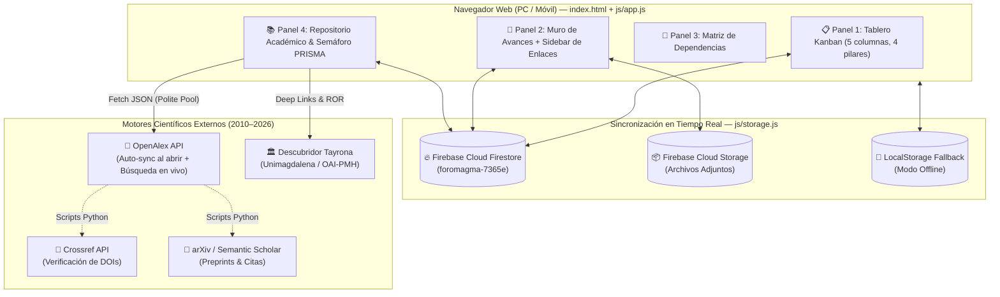

# 📘 Documentación Técnica Completa — Proyecto ForoMagma

**Ubicación Local:** `C:\Users\LENOVO\Desktop\Anty\ForoMagma`  
**URL en Vivo (Producción):** [https://ivanmezaf-wq.github.io/ForoMagma/](https://ivanmezaf-wq.github.io/ForoMagma/)  
**Repositorio GitHub:** [https://github.com/ivanmezaf-wq/ForoMagma](https://github.com/ivanmezaf-wq/ForoMagma)  
**Contexto Académico:** Tesis de Ingeniería Electrónica — Santa Marta, Colombia (Universidad del Magdalena).  
**Temática Central:** Baterías de Ion de Litio, Segunda Vida (*Second-Life Batteries*), Sistemas de Gestión de Baterías (*BMS*), Estimación de Estado de Salud (*SoH*) y Estado de Carga (*SoC*), y Protocolos de Carga Rápida.

---

## 1. Resumen Ejecutivo de la Arquitectura

**ForoMagma** fue concebido como una aplicación web *Serverless* de página única (SPA modular en Vanilla JavaScript ES6+, HTML5 semántico y CSS3 con variables dinámicas) conectada en tiempo real a **Google Firebase (Firestore + Storage)** y a **APIs bibliométricas científicas internacionales**.

### Diagrama de Arquitectura del Sistema



---

## 2. Directorio Completo de Enlaces y Endpoints

### 2.1. Enlaces de Infraestructura del Proyecto
* **Página Web Desplegada (GitHub Pages):** `https://ivanmezaf-wq.github.io/ForoMagma/`
* **Repositorio Git Remoto:** `https://github.com/ivanmezaf-wq/ForoMagma.git`
* **Consola Firebase del Proyecto:** `https://console.firebase.google.com/project/foromagma-7365e`
* **ID del Proyecto Firebase:** `foromagma-7365e`
* **Dominio de Autenticación/App Firebase:** `foromagma-7365e.firebaseapp.com`
* **Bucket de Almacenamiento Firebase:** `foromagma-7365e.firebasestorage.app`

### 2.2. Enlaces Académicos y APIs Científicas Utilizadas
* **OpenAlex Works API (Endpoint Principal):** `https://api.openalex.org/works`
  * *Ejemplo de consulta en vivo (2010–2026):*  
    `https://api.openalex.org/works?search=second%20life%20lithium%20ion%20battery%20BMS%20SoH&filter=publication_year:2010-2026&per_page=25&sort=publication_year:desc&mailto=ivanmezaf@users.noreply.github.com`
* **Crossref Works API:** `https://api.crossref.org/works`
* **arXiv Query API:** `http://export.arxiv.org/api/query`
* **Semantic Scholar Graph API:** `https://api.semanticscholar.org/graph/v1/paper/search`
* **Descubridor Tayrona — Universidad del Magdalena (Búsqueda Baterías de Litio):**  
  `https://descubridor.unimagdalena.edu.co/primo-explore/search?query=any,contains,baterias%20de%20litio&tab=default_tab&search_scope=default_scope&vid=UNIMAGDALENA`
* **Descubridor Tayrona — Universidad del Magdalena (Búsqueda BMS):**  
  `https://descubridor.unimagdalena.edu.co/primo-explore/search?query=any,contains,BMS%20baterias&tab=default_tab&search_scope=default_scope&vid=UNIMAGDALENA`
* **Repositorio Institucional Unimagdalena (Facultad de Ingeniería):**  
  `https://repositorio.unimagdalena.edu.co/handle/123456789/2`
* **Endpoint OAI-PMH Repositorio Unimagdalena:**  
  `https://repositorio.unimagdalena.edu.co/oai/request?verb=Identify`
* **Identificador ROR de la Universidad del Magdalena en OpenAlex:**  
  `https://ror.org/03y6f7g43`

---

## 3. Especificación Técnica de Funcionamiento

### 3.1. Sincronización Automática con OpenAlex (`autoSyncOpenAlex`)
Cada vez que se carga la página (`DOMContentLoaded`), la función `autoSyncOpenAlex()` en `js/app.js` realiza los siguientes pasos:
1. Envía una petición HTTP `GET` asíncrona a `api.openalex.org/works` filtrando por el intervalo `publication_year:2010-2026` y ordenando de más reciente a más antiguo (`publication_year:desc`).
2. Reconstruye los resúmenes (*abstracts*) a partir de la estructura `abstract_inverted_index` devuelta por OpenAlex (mapeando cada palabra a sus índices de posición y uniéndolas en orden).
3. Clasifica automáticamente el ámbito geográfico (`🇨🇴 Colombia / Local`, `🌎 Latinoamérica`, `🌐 Internacional`) y la categoría temática de la tesis (`Segunda Vida`, `BMS Segunda Vida`, `SoH (Salud)`, `SoC (Carga)`, `Carga Rápida`).
4. Verifica duplicados comparando el **DOI normalizado** y el **título en minúsculas** contra `state.papers`.
5. Ordena toda la colección de forma estrictamente descendente por año (**2026 $\rightarrow$ 2010**) y desempatando por número de citas.

### 3.2. Clasificación con Semáforo Metodológico PRISMA (`🟢` / `🟡` / `🔴`)
Para cumplir con el rigor de una Revisión Sistemática de Literatura (estándar PRISMA), tanto los artículos científicos como los enlaces del foro cuentan con tres botones de estado a la derecha:
* **Clave única de artículo (`getPaperKey`):** Basada en el DOI sanitizado (`doi_10_1016_...`) o un hash determinístico de 32 bits (`hashString`) del título.
* **Clave única de enlace (`linkKey`):** Basada en el hash de la URL (`lnk_<hash>`).
* **Persistencia Dual:**
  * Se guarda inmediatamente en `localStorage` (`foromagma_paper_ratings` y `foromagma_link_ratings`).
  * Se sincroniza en la nube en el documento `ratings/classification_map` de **Cloud Firestore** mediante `{ merge: true }`, actualizando en tiempo real las pantallas de todos los integrantes del equipo.

### 3.3. Sistema de Diseño y Modo Oscuro (`css/styles.css`)
* Inspirado en un diseño editorial técnico de alto contraste (*TaganAzul*).
* Variables CSS reactivas bajo `:root` y `[data-theme="dark"]`, persistiendo la preferencia del usuario en `localStorage.getItem('foromagma_theme')`.

---

## 4. Comandos de Mantenimiento y Despliegue

Para actualizar el repositorio en GitHub desde la nueva ruta en tu Escritorio (`C:\Users\LENOVO\Desktop\Anty\ForoMagma`):

```powershell
# 1. Ir a la carpeta del proyecto
cd "C:\Users\LENOVO\Desktop\Anty\ForoMagma"

# 2. Verificar estado de archivos
git status

# 3. Guardar cambios y subirlos a la web en vivo
git add .
git commit -m "Actualización del proyecto ForoMagma"
git push origin main
```
